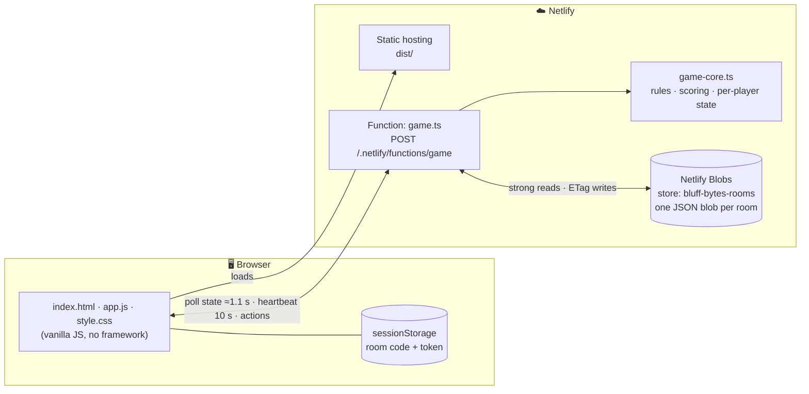
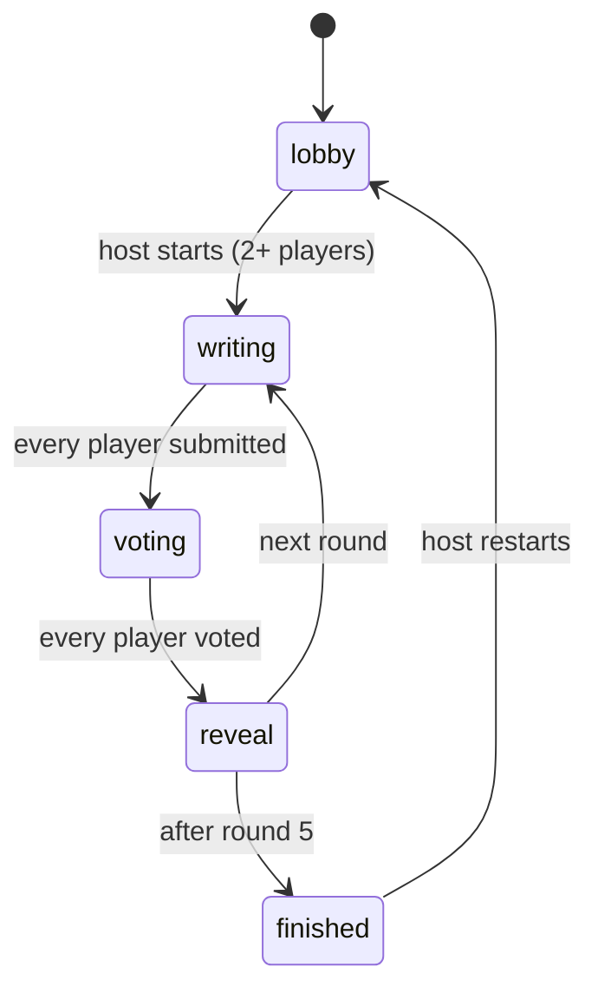

<div align="center">


<br/>

<a href="https://gleaming-squirrel-0b0864.netlify.app/"></a>
<a href="https://github.com/taj-shabreen/bluff-bytes"></a>

<br/><br/>


<br/>


</div>

<br/>

## 🎭 What is Bluff Bytes?

Every round shows a real computer science or AI term. Everyone secretly writes a **fake definition** for it. The server mixes the **real definition** in with the fakes, shuffles the lineup, and hides who wrote what. Then everyone votes for the one they think is true.

Find the truth and you score. Fool a friend with your bluff and you score too. After five terms, the highest score wins.

No accounts. No installs. Create a room, share a six-character code, and play in the browser.

<br/>

## 📸 Screenshots

<p align="center">
  
</p>
<p align="center">
  
</p>
<p align="center">
  
</p>

<p align="center"><b>▶ <a href="https://gleaming-squirrel-0b0864.netlify.app/">Play the live demo</a></b></p>

<br/>

## ✨ Features

Everything below is implemented in the source (`netlify/game-core.ts`, `netlify/functions/game.ts`, `app.js`).

| | Feature | Details |
|---|---|---|
| 👥 | **2–8 player rooms** | Join with a nickname (2–20 characters, unique per room, case-insensitive). The room rejects a 9th player. |
| 🔑 | **Room codes + invite links** | Six-character hex code (`0-9A-F`). Tap the code to copy it, or copy an invite link that opens the join form pre-filled (`/?room=CODE`). |
| ✍️ | **Fake definitions** | Each player writes one bluff per round, 8–240 characters, validated on the server. |
| 🎲 | **Real definition, shuffled in** | The server inserts the true definition at a random position once every player has submitted. |
| 🕵️ | **Anonymous answers** | Author IDs are never sent to voters. Your own bluff is marked so you can't pick it. |
| 🗳️ | **One vote per round** | Duplicate votes and self-votes are rejected server-side, not just in the UI. |
| 🏆 | **Scoring + live leaderboard** | **+2** for finding the real definition, **+1** for each player your bluff fools. The leaderboard updates throughout the game. |
| 🔍 | **Round reveal** | Shows the true definition, vote counts per answer, and the names of players each bluff fooled. |
| 🔁 | **Five rounds + winner screen** | Five terms across AI, machine learning, computer science, and networking. Ties are announced as ties. The host can start a new game from the same room. |
| 📡 | **Reconnect support** | Your seat is tied to a session token. A heartbeat keeps presence current, and dropped players show as *reconnecting* instead of disappearing. |
| ⚡ | **Serverless backend** | One Netlify Function, with room state stored in Netlify Blobs. No database to run. |
| 📱 | **Responsive terminal UI** | Retro terminal styling with breakpoints at 860, 720, and 390 px, and a reduced-motion mode. |

<br/>

## 🎮 How to Play

1. **Open the game** → [gleaming-squirrel-0b0864.netlify.app](https://gleaming-squirrel-0b0864.netlify.app/)
2. **Create a room** with a nickname, or **join** one with a room code. The host shares the code or invite link.
3. **Wait in the lobby.** The host starts once at least 2 players have joined. Nobody can join after the game starts.
4. **Write a bluff.** A term appears, such as *Backpropagation*. Write a fake definition that sounds convincing.
5. **Vote.** Once everyone has submitted, the lineup appears with the real definition mixed in. Pick the one you think is true.
6. **Score.** Correct vote = **+2**. Each player fooled by your bluff = **+1** for you.
7. **Repeat for five rounds**, then see the winner and final leaderboard. The host can hit **Play again**.

<br/>

## 🏗️ Architecture

Bluff Bytes is a static frontend plus **one serverless endpoint**. The browser polls that endpoint for state and posts actions to it. All game rules run on the server, so clients never see answer authors or the real definition early.



### Round lifecycle



### How the pieces fit

| Layer | What it does |
|---|---|
| **Frontend** (`index.html`, `app.js`, `style.css`) | Renders the home, lobby, round, and winner screens from the state the server returns. Polls every ~1.1 s and sends a heartbeat every 10 s. |
| **API** (`netlify/functions/game.ts`) | Single endpoint that handles `create`, `join`, `state`, `heartbeat`, `start`, `submit`, `vote`, `next`, and `restart`. |
| **Game logic** (`netlify/game-core.ts`) | Holds the five terms, the room model, validation, scoring, and `publicState()`, which filters what each player may see. Kept outside `netlify/functions/` so it's shared and testable. |
| **Storage** (Netlify Blobs) | Each room is one JSON blob keyed by its room code. Writes use `onlyIfMatch` (ETag) with up to 14 retries. Room-code reservation uses `onlyIfNew`. |
| **Build** (`scripts/build.mjs`) | Copies the three browser files into `dist/` and bundles the Function and test with esbuild. |

### Consistency model

Netlify Blobs is key-value storage, not a transactional database. Bluff Bytes keeps each game transition inside a single conditionally-written blob. If two players act at once, the stale write is rejected and re-applied to the latest snapshot, so overlapping submissions and votes are re-validated before they commit. This suits a small party game. For much higher traffic or strict transactional guarantees, move room state to a transactional database. Rooms don't expire automatically in this version.

<br/>

## 🧰 Tech Stack

| Layer | Technology |
|---|---|
| **Frontend** | HTML5, CSS3, vanilla JavaScript. No framework. Fonts: DM Mono and Space Grotesk via Google Fonts |
| **Backend** | Netlify Functions (TypeScript, Web `Request`/`Response` handler) |
| **Storage** | Netlify Blobs (`@netlify/blobs`) |
| **Types / build** | TypeScript 5 (`tsc --noEmit`), esbuild |
| **Runtime** | Node.js 20 or newer |
| **Hosting** | Netlify (static `dist/` plus Functions) |

<br/>

## 🚀 Getting Started

### Prerequisites

- **Node.js 20+** and npm
- **Netlify CLI** for running the Function locally. It isn't a project dependency, so use `npx netlify dev` as shown below.

### Install and build

```bash
git clone https://github.com/taj-shabreen/bluff-bytes.git
cd bluff-bytes
npm install
npm run build
```

`npm run build` copies the browser files to `dist/`, compiles the Function bundle, and type-checks `netlify/**/*.ts`.

### Run locally

```bash
npx netlify dev
```

Open <http://localhost:8888>. Netlify Dev emulates Functions and Blobs, so local rooms are separate from the deployed site. Open a second browser window (or a private window) to play as a second player.

### Test

```bash
npm run test:game
```

This builds, then runs the real Function handler against an in-memory blob store through a full two-player, five-round game. It checks:

- Room creation and joining
- Concurrent submissions and votes with retry handling
- Anonymous answers and hidden real definition before the reveal
- Self-vote and duplicate-vote rejection
- The +2 / +1 scoring
- Disconnect and reconnect, and the final winner

<br/>

## 📁 Project Structure

```text
bluff-bytes/
├── index.html              # App shell: top bar and #app mount point
├── app.js                  # Browser client: screens, polling, heartbeat, actions
├── style.css               # Retro terminal theme and responsive styles
├── netlify/
│   ├── functions/
│   │   └── game.ts         # Netlify Function: the single game API
│   └── game-core.ts        # Terms, rules, scoring, per-player state filtering
├── scripts/
│   ├── build.mjs           # Copies static files to dist/, bundles Function + test
│   └── test-game.ts        # End-to-end game test (in-memory blob store)
├── docs/
│   ├── assets/banner.svg   # Animated README banner
│   └── screenshots/        # README screenshots
├── netlify.toml            # Build command, publish dir, functions dir, dev port
├── package.json            # Scripts and dependencies
├── package-lock.json
├── tsconfig.json           # Strict type-checking for netlify/**/*.ts
└── dist/                   # Generated by `npm run build`
```

<br/>

## 👩‍💻 Developer

**Shabreen Taj** · AI/ML developer and B.Tech CSE student

<p>
  <a href="https://github.com/taj-shabreen"></a>
  <a href="https://pshabreentaj.com"></a>
  <a href="https://linkedin.com/in/shabreen-taj77"></a>
</p>

<div align="center">

<br/>

If you enjoyed the bluffing, a ⭐ on the repo is appreciated.

</div>
